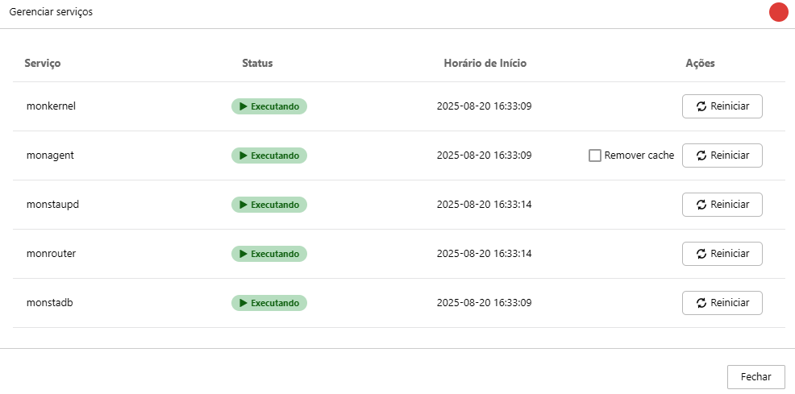

The **Manage Services** screen provides an overview of the status of the essential services for Monsta's operation. It allows you to monitor and manage each service individually, ensuring the system runs without interruptions.

## How to Use

On this screen, you will see a list of services, each with the following information:

- **Service Name**: The name of the running service.
- **Status**: The current state of the service, indicated by a status icon. The most common statuses are:
  - **Green**: The service is **active** and functioning correctly.
  - **Red**: The service is **inactive** or experiencing an issue.
- **Start Time**: Shows the date and time when the service was started.
- **Actions**: In this column, you will find the button to **restart** the service.
  - **Restart**: Click this button to restart a specific service. This can be useful to resolve isolated issues without needing to restart the entire system.

## Services

| Serviço | Descrição |
| --- | --- |
| `monkernel` | It is the core of the system, responsible for logs and the interface between the other services and the database. |
| `monagent` | Responsible for collecting information from devices. |
| `monstaupd` | It is the subsystem that periodically checks for new Monsta updates. |
| `monrouter` | It is the HTTP server responsible for providing the HTTP interface to the user. |
| `monstadb` | Database for collected information. |

:::tip
If you need to restart the services via the command line (Linux), see the article [Managing Monsta Services via Command Line (Linux)](/en/tech/guias-tecnicos/gerenciamento-de-servicos-do-monsta-via-linha-de-comando).
:::