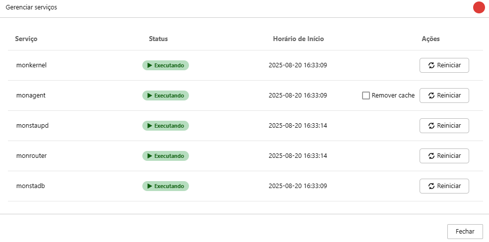

La pantalla **Administrar Servicios** ofrece una vista general del estado de los servicios esenciales para el funcionamiento de Monsta. Permite que supervise y gestione cada servicio individualmente, garantizando que el sistema opere sin interrupciones.

## Cómo Usar

En esta pantalla, verá una lista de servicios, cada uno con la siguiente información:

- **Nombre del Servicio**: El nombre del servicio en ejecución.
- **Estado**: El estado actual del servicio, indicado por un icono de estado. Los estados más comunes son:
  - **Verde**: El servicio está **activo** y funcionando correctamente.
  - **Rojo**: El servicio está **inactivo** o con algún problema.
- **Fecha y hora de inicio**: Indica la fecha y hora en que se inició el servicio.
- **Acciones**: En esta columna encontrará el botón para **reiniciar** el servicio.
  - **Reiniciar**: Haga clic en este botón para reiniciar un servicio específico. Esto puede ser útil para resolver problemas puntuales sin tener que reiniciar todo el sistema.

## Servicios

| Servicio | Descripción |
| --- | --- |
| `monkernel` | Es el núcleo del sistema, responsable de los logs y la interfaz entre los demás servicios y la base de datos. |
| `monagent` | Responsable de la recopilación de información de los equipos. |
| `monstaupd` | Es el subsistema que comprueba periódicamente si hay nuevas actualizaciones de Monsta. |
| `monrouter` | Es el servidor HTTP responsable de proporcionar la interfaz HTTP para el usuario. |
| `monstadb` | Base de datos de las recopilaciones de información. |

:::tip
Si necesita reiniciar los servicios desde la línea de comandos (Linux), consulte el artículo [Gerenciamento de Serviços do Monsta via Linha de Comando (Linux)](/es/tech/guias-tecnicos/gerenciamento-de-servicos-do-monsta-via-linha-de-comando).
:::